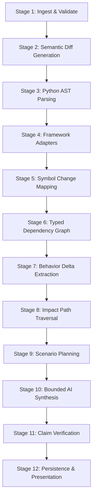

# DiffBeacon 12-Stage Analysis Pipeline Specification

**Version:** 1.0.0  
**Status:** Approved  
**Date:** October 2026  

---

## 1. Pipeline Overview

The analysis engine executes a multi-stage, deterministic pipeline designed to ensure that no AI synthesis ever manufactures a file, function, line number, dependency edge, or contract.

---

## 2. Stage-by-Stage Detailed Specification

### Stage 1: Ingest and Validate
- **Input:** Two source archives (Base ZIP and Head ZIP) or pre-indexed fixture paths.
- **Actions:**
  - Enforce max archive size, max files, and directory depth.
  - Test for path traversal (`..`, symlinks, absolute paths).
  - Unpack into temporary, isolated snapshot directories.
  - Compute SHA-256 hashes per file and for snapshot root.
  - Classify files: `source` (Python), `test` (`tests/`, `test_*.py`), `migration` (`migrations/`), `config` (`settings.py`, `Pipfile`), or `skipped` (binary, docs).
- **Output:** Stored `SourceSnapshot` and `SourceFile` records.

### Stage 2: Diff Generation
- **Input:** File manifests of Base and Head snapshots.
- **Actions:**
  - Detect added files (present in head, absent in base).
  - Detect deleted files (present in base, absent in head).
  - Detect modified files (hash mismatch between base and head).
  - Best-effort rename detection via similarity hashing.
  - Compute unified diffs and record changed line ranges per file `[start_line, end_line]`.
- **Output:** Normalized file-level diff catalog.

### Stage 3: Python AST Parsing
- **Input:** All active Python source files in both snapshots.
- **Actions:**
  - Parse using `ast.parse(source, filename)`.
  - Extract modules, class declarations, function definitions, parameters, default arguments, return annotations.
  - Extract call sites (`ast.Call`), attribute lookups (`ast.Attribute`), and imports (`ast.Import`, `ast.ImportFrom`).
  - Compute normalized AST fingerprints for every symbol.
- **Output:** Snapshot-isolated `Symbol` tables.

### Stage 4: Framework Adapters (Django & DRF)
- **Input:** Parsed AST symbols and syntax trees.
- **Actions:**
  - **URL Routing Adapter:** Inspect `urlpatterns`, `path()`, `re_path()`, and DRF `DefaultRouter` registrations to resolve API route contracts (e.g. `GET /api/v1/employees/` -> `EmployeeViewSet.list`).
  - **DRF Serializer Adapter:** Inspect classes inheriting from `Serializer` or `ModelSerializer`. Extract field names, field classes (e.g. `CharField`, `IntegerField`), `required`, `allow_null`, `default`, and custom `validate_<field>` methods.
  - **Django Model Adapter:** Inspect models inheriting from `models.Model`. Extract fields, constraints, default values, `blank`/`null` flags, and relationship keys (`ForeignKey`, `ManyToManyField`).
  - **View & Permission Adapter:** Extract authentication classes and permission classes (`IsAuthenticated`, custom permissions).
- **Output:** Structured Framework Contract Catalog.

### Stage 5: Symbol Mapping
- **Input:** Changed line ranges from Stage 2 + Symbol tables from Stage 3.
- **Actions:**
  - Map every changed line range to enclosing symbols in base and head.
  - Identify symbol state: `added`, `deleted`, `modified_body`, `modified_signature`, `unmodified`.
  - Pair base symbols with head symbols using qualified names and AST structural fingerprints.
- **Output:** Changed Symbol Inventory.

### Stage 6: Typed Dependency Graph
- **Input:** Base and Head symbol tables, call expressions, and framework mappings.
- **Actions:**
  - Construct two independent directed graphs: $G_{base}$ and $G_{head}$.
  - Edges created:
    - `imports`: Module A imports Module B.
    - `calls`: Function A calls Function B.
    - `routes_to`: Route pattern points to View.
    - `serializes`: View uses Serializer.
    - `reads_model` / `writes_model`: View or Service accesses Model.
    - `tests`: Test method targets Function/Class.
  - Edge metadata records file, line number, provenance (`ast_static`, `framework_rule`), and certainty.
- **Output:** Stored `RelationshipEdge` records.

### Stage 7: Behavior-Delta Extraction
- **Input:** Changed symbols, framework contracts, and AST diffs.
- **Actions:**
  - Deterministically identify behavioral shift categories:
    - *API Contract Shift:* Serializer field requirement changed (required -> optional).
    - *Validation Rule Shift:* New validation check or altered conditional boundary.
    - *Model Default Shift:* Changed model field default affecting database writes.
    - *Permission Condition Shift:* Altered logic in `has_permission` or `has_object_permission`.
    - *Error Handling Shift:* Changed exception catching or return status code.
- **Output:** `BehaviorDelta` and `ContractDelta` records with exact source citations.

### Stage 8: Impact-Path Analysis
- **Input:** Changed symbols + Dependency Graph ($G_{head}$).
- **Actions:**
  - Traversal via bounded Breadth-First Search (BFS) up to max radius (default 4 hops).
  - Detect cycles and avoid infinite recursion.
  - Discover:
    - Direct callers (Immediate Blast Radius).
    - Connected API entry points (Upstream Ingress).
    - Connected database models (Downstream Persistence).
    - Connected test cases.
- **Output:** Impact Paths and Blast Radius summaries.

### Stage 9: Scenario Planning
- **Input:** User question or pre-configured scenario starter + Analysis context.
- **Actions:**
  - Normalize developer question into a structured scenario condition.
  - Identify relevant entry points (e.g. `POST /api/v1/employees/`).
  - Trace candidate execution paths in $G_{base}$ from entry point to changed symbol.
  - Trace candidate execution paths in $G_{head}$ from entry point to changed symbol.
  - Identify where the two paths diverge in code conditions or contracts.
- **Output:** Structured Scenario Plan with Candidate Base & Head Paths.

### Stage 10: Evidence-Limited AI Synthesis
- **Input:** Bounded Context Package only:
  - Exact candidate path nodes and source line ranges.
  - Before/after code snippets (strictly extracted from stored files).
  - Detected contract deltas.
  - Prompt with rigid JSON schema requiring citations for every claim.
- **Actions:**
  - Dispatch to LLM Provider (`mock`, `openai`, `anthropic`).
  - Generate scenario interpretation, behavioral comparison, impact explanation, and verification plan.
- **Output:** Candidate Scenario Trace JSON.

### Stage 11: Claim Verification & Grounding Guardrail
- **Input:** Candidate Scenario Trace JSON from Stage 10.
- **Actions:**
  - **Source Existence Check:** Verify that every file cited exists in the snapshot.
  - **Line Range Check:** Verify that cited line numbers correspond to the cited symbols.
  - **Edge Validation:** Verify that cited transitions correspond to stored graph edges.
  - **Label Enforcer:** Enforce provenance labels: downgrade unsupported statements to `unresolved` or reject them.
- **Output:** Verified, grounded `ScenarioQuery`, `ScenarioTrace`, and `VerificationCase` records.

### Stage 12: Persistence & Presentation
- **Input:** All verified pipeline artifacts.
- **Actions:**
  - Commit all records to the database within an atomic transaction.
  - Update `AnalysisRun` status to `completed` with stage timestamps.
  - Expose artifacts through the REST API `/api/v1/analyses/{id}/`.
- **Output:** Change Story ready for exploration in the UI.
