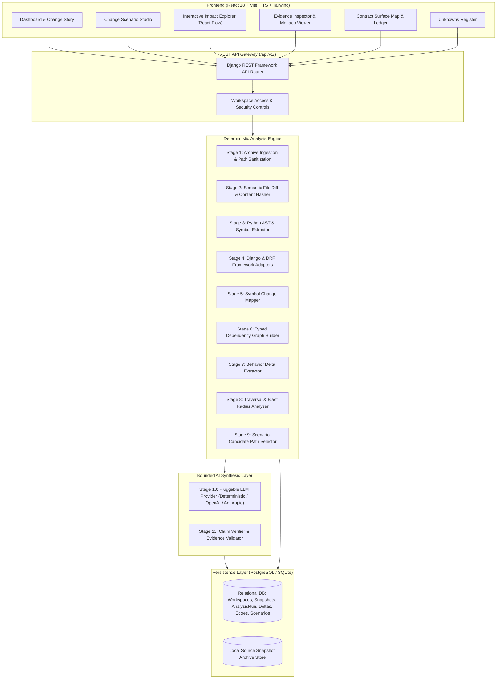

# DiffBeacon Architecture Specification

**Version:** 1.0.0  
**Status:** Approved & Implemented  
**Date:** October 2026  

---

## 1. High-Level Architecture

DiffBeacon is structured as a **modular monolith** with a strict separation between deterministic code intelligence and bounded AI synthesis.



---

## 2. Monorepo Structure and Boundaries

```
DiffBeacon/
├── frontend/                     # React 18 + TypeScript + Vite + Tailwind CSS
│   ├── src/
│   │   ├── app/                  # App router, layout, navigation, providers
│   │   ├── components/           # Reusable UI primitives (buttons, modals, badges, cards)
│   │   ├── features/
│   │   │   ├── dashboard/        # Recent analyses, demo launcher, upload modal
│   │   │   ├── changes/          # Behavior Delta Ledger
│   │   │   ├── contracts/        # Contract Surface Map
│   │   │   ├── scenarios/        # Change Scenario Studio
│   │   │   ├── impact-graph/     # React Flow interactive dependency graph
│   │   │   ├── verification/     # Verification Matrix & test recommendations
│   │   │   ├── evidence/         # Source viewer with side-by-side diff & line highlights
│   │   │   ├── unknowns/         # Unknowns & uncertainty ledger
│   │   │   └── history/          # Historical runs and claim diff comparison
│   │   ├── lib/                  # API client, graph layout utilities, formatters
│   │   └── types/                # TypeScript interfaces mirror backend schemas
│   ├── tests/                    # Vitest unit and component tests
│   ├── package.json
│   ├── tailwind.config.js
│   └── vite.config.ts
│
├── backend/                      # Python 3.11 + Django 5 + Django REST Framework
│   ├── config/                   # Settings, wsgi/asgi, urls router
│   ├── apps/
│   │   ├── workspaces/           # Workspace models and tenancy management
│   │   ├── snapshots/            # SourceSnapshot and SourceFile models
│   │   ├── ingestion/            # ZIP upload, safe extraction, file validation
│   │   ├── code_index/           # Python AST parser, symbol extractor
│   │   ├── contracts/            # DRF serializers, Django routes/models/views
│   │   ├── impacts/              # Typed graph nodes, edges, cycle detection
│   │   ├── analysis/             # Pipeline orchestrator, BehaviorDelta, Unknowns
│   │   ├── scenarios/            # Candidate paths, scenario planner, synthesis
│   │   ├── verification/         # Test discovery and verification recommendations
│   │   ├── evidence/             # Source ranges, line references, claim validation
│   │   ├── history/              # Analysis run versioning and comparison
│   │   └── integrations/         # Pluggable LLM interface (Mock + Cloud LLMs)
│   ├── tests/                    # Pytest test suite covering all apps
│   ├── manage.py
│   └── requirements.txt
│
├── fixtures/
│   └── beaconworks_api/          # Realistic sample Django/DRF application
│       ├── base/                 # Base version (v1.0 baseline)
│       ├── head/                 # Head version (v1.1 with changes & regressions)
│       └── expected/             # Expected AST facts, contract deltas, scenarios
│
├── docs/                         # Specifications, contracts, architecture, and guides
├── scripts/                      # Setup, demo seeding, and test runner scripts
├── docker-compose.yml            # Containerized PostgreSQL, Redis, Backend, Frontend
├── .env.example                  # Documented environment variables
└── README.md                     # Quickstart, architecture overview, and usage guide
```

---

## 3. Core Subsystems and Responsibilities

### 3.1 Ingestion & Source Sanitization (`apps/ingestion`)
- Safely accepts source ZIP archives (base and head).
- Enforces strict security bounds:
  - Max archive size (default 25 MB).
  - Max uncompressed file count (default 1,000 files).
  - Max individual file size (default 2 MB).
  - Path traversal defense: validates every zip entry against canonical base path.
  - Ignores binary files, virtual environments (`.venv`), `.git`, `node_modules`, `__pycache__`.

### 3.2 Code Index & Static Analysis (`apps/code_index`, `apps/contracts`)
- Uses Python's native `ast` module to extract structural symbols:
  - Modules, Classes, Functions, Methods, Parameters, Default Values, Return Types.
  - Imports (`Import`, `ImportFrom`) and aliases.
  - Call expressions (`Call`) and attribute lookups (`Attribute`).
- Framework-aware extraction via DRF and Django adapters:
  - URLs: `path()`, `re_path()`, `DefaultRouter` registrations.
  - Serializers: DRF `Serializer` and `ModelSerializer` fields, `required` flags, `validate_<field>` methods.
  - Models: Django `models.Model` fields, `blank`, `null`, `default`, `on_delete`, and constraints.
  - Views: Class-based views (`APIView`, `ModelViewSet`), method handlers (`get`, `post`, `patch`, `delete`).

### 3.3 Typed Dependency Graph (`apps/impacts`)
- Creates directed relationship edges with explicit types and provenance:
  - `imports`: Module import dependencies.
  - `calls`: Direct function/method invocations.
  - `references`: Symbol name references in bodies.
  - `routes_to`: Django URL pattern -> View handler.
  - `serializes`: View handler -> DRF Serializer.
  - `reads_model` / `writes_model`: View/Service -> Django Model.
  - `tests`: Test function -> Target symbol.
- Separates Base Graph and Head Graph to prevent cross-contamination during diff traversal.

### 3.4 Behavior Delta Extraction (`apps/analysis`)
- Compares AST representations between Base and Head snapshots:
  - Detects signature changes (added/removed/reordered parameters).
  - Detects contract modifications (e.g., serializer field changed from required to optional).
  - Detects altered conditional logic and validation branches.
  - Extracts exact before/after source excerpts with line numbers.

### 3.5 Change Scenario Studio (`apps/scenarios`)
- Translates user behavior questions into typed candidate queries.
- Determines candidate execution paths deterministically:
  - Traces entry points (views) down through serializers, services, and models.
- Builds a bounded context package with zero invented data:
  - Exact source snippets.
  - Active graph paths.
  - Detected contract differences.
- Sends package to the configured LLM Provider (or Deterministic Mock Provider in demo mode).
- Validates LLM outputs against stored symbols and edges; rejects fabricated references.

### 3.6 Verification & Unknowns (`apps/verification`, `apps/analysis`)
- Discovers existing test files and identifies whether touched symbols are exercised.
- Generates concrete verification cases with preconditions, inputs, and expected outcomes.
- Emits explicit entries in the **Unknowns Register** for dynamic dispatches (`getattr`, `eval`, `*args`), unresolvable third-party imports, or runtime-dependent configurations.
