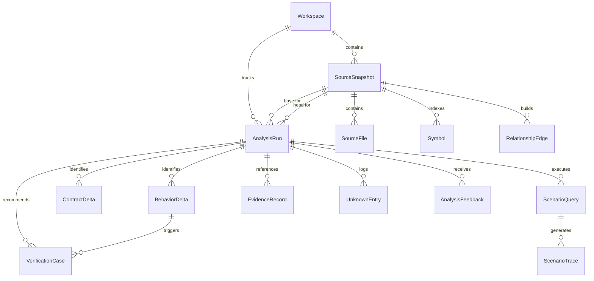

# DiffBeacon Data Model Specification

**Version:** 1.0.0  
**Status:** Approved  
**Date:** October 2026  

---

## 1. Entity-Relationship Overview

The DiffBeacon persistence layer is designed to support immutable snapshot comparisons, source-backed evidence traces, and strict epistemic provenance tracking.

---

## 2. Entity Definitions

### 2.1 `Workspace`
Represents an isolated project boundary or tenant.
- `id` (UUID, Primary Key)
- `name` (CharField, max_length=255)
- `slug` (SlugField, unique=True)
- `description` (TextField, blank=True)
- `created_at` (DateTimeField, auto_now_add=True)
- `updated_at` (DateTimeField, auto_now=True)
- `is_demo` (BooleanField, default=False)
- `retention_days` (IntegerField, default=30)

### 2.2 `SourceSnapshot`
An immutable snapshot representing a distinct code version (base or head).
- `id` (UUID, Primary Key)
- `workspace` (ForeignKey to Workspace, on_delete=CASCADE)
- `label` (CharField, max_length=100) — e.g. "v1.0-base" or "PR-102-head"
- `source_hash` (CharField, max_length=64) — SHA-256 of entire snapshot content
- `storage_path` (CharField, max_length=512) — Absolute/relative directory path of extracted source
- `file_count` (IntegerField, default=0)
- `total_bytes` (BigIntegerField, default=0)
- `ingestion_status` (CharField: `pending`, `ingesting`, `ready`, `failed`)
- `created_at` (DateTimeField, auto_now_add=True)

### 2.3 `SourceFile`
Represents a source file inside an ingested snapshot.
- `id` (UUID, Primary Key)
- `snapshot` (ForeignKey to SourceSnapshot, on_delete=CASCADE)
- `relative_path` (CharField, max_length=512) — e.g., `api/views/employee.py`
- `content_hash` (CharField, max_length=64) — SHA-256 of file contents
- `language` (CharField, max_length=50) — `python`, `json`, `markdown`, etc.
- `file_classification` (CharField: `source`, `test`, `migration`, `config`, `doc`)
- `line_count` (IntegerField, default=0)
- `parse_status` (CharField: `parsed`, `syntax_error`, `skipped`, `binary`)
- `error_message` (TextField, blank=True)

### 2.4 `AnalysisRun`
An immutable, versioned comparison between a base and head snapshot.
- `id` (UUID, Primary Key)
- `workspace` (ForeignKey to Workspace, on_delete=CASCADE)
- `base_snapshot` (ForeignKey to SourceSnapshot, on_delete=CASCADE, related_name='base_analyses')
- `head_snapshot` (ForeignKey to SourceSnapshot, on_delete=CASCADE, related_name='head_analyses')
- `status` (CharField: `queued`, `running`, `completed`, `failed`, `cancelled`)
- `current_stage` (CharField, max_length=50) — e.g., `stage_6_typed_graph`
- `stages_completed` (JSONField, default=list)
- `engine_version` (CharField, max_length=50, default="1.0.0")
- `ai_provider_name` (CharField, max_length=50) — `mock`, `openai`, `anthropic`
- `error_details` (JSONField, default=dict)
- `started_at` (DateTimeField, null=True)
- `completed_at` (DateTimeField, null=True)
- `created_at` (DateTimeField, auto_now_add=True)

### 2.5 `Symbol`
A parsed code entity within a specific snapshot.
- `id` (UUID, Primary Key)
- `snapshot` (ForeignKey to SourceSnapshot, on_delete=CASCADE)
- `file_path` (CharField, max_length=512)
- `name` (CharField, max_length=255)
- `qualified_name` (CharField, max_length=512) — e.g. `api.views.EmployeeViewSet.retrieve`
- `symbol_type` (CharField: `module`, `class`, `function`, `method`, `variable`, `contract`)
- `start_line` (IntegerField)
- `end_line` (IntegerField)
- `signature` (TextField, blank=True)
- `docstring` (TextField, blank=True)
- `fingerprint` (CharField, max_length=64) — normalized AST hash for identity comparison
- `metadata` (JSONField, default=dict) — framework-specific tags (e.g. `is_drf_serializer: true`)

### 2.6 `RelationshipEdge`
A verified, typed edge in the snapshot's dependency graph.
- `id` (UUID, Primary Key)
- `snapshot` (ForeignKey to SourceSnapshot, on_delete=CASCADE)
- `source_symbol_qname` (CharField, max_length=512)
- `target_symbol_qname` (CharField, max_length=512)
- `edge_type` (CharField: `imports`, `calls`, `references`, `routes_to`, `serializes`, `reads_model`, `writes_model`, `tests`)
- `provenance` (CharField: `ast_static`, `framework_rule`, `inferred`)
- `certainty` (CharField: `definite`, `probable`, `ambiguous`)
- `source_file` (CharField, max_length=512)
- `line_number` (IntegerField, null=True)

### 2.7 `BehaviorDelta`
A discrete behavioral change detected between base and head.
- `id` (UUID, Primary Key)
- `analysis` (ForeignKey to AnalysisRun, on_delete=CASCADE, related_name='deltas')
- `category` (CharField: `api_contract`, `validation`, `signature`, `permission`, `data_model`, `error_handling`, `logic`)
- `title` (CharField, max_length=255)
- `summary` (TextField)
- `before_behavior` (TextField)
- `after_behavior` (TextField)
- `affected_symbol` (CharField, max_length=512)
- `file_path` (CharField, max_length=512)
- `base_line_range` (JSONField) — `[start, end]`
- `head_line_range` (JSONField) — `[start, end]`
- `confidence` (CharField: `statically_established`, `framework_rule`, `inferred`, `unresolved`)
- `evidence_refs` (JSONField, default=list)

### 2.8 `ContractDelta`
Structured interface contract comparisons.
- `id` (UUID, Primary Key)
- `analysis` (ForeignKey to AnalysisRun, on_delete=CASCADE, related_name='contracts')
- `contract_type` (CharField: `drf_serializer`, `api_route`, `django_model`, `service_signature`)
- `identifier` (CharField, max_length=512) — e.g. `EmployeeSerializer.department_id` or `GET /api/v1/employees/`
- `change_nature` (CharField: `added`, `removed`, `modified_optional`, `modified_required`, `type_change`)
- `before_spec` (JSONField, default=dict)
- `after_spec` (JSONField, default=dict)
- `is_breaking` (BooleanField, default=False)
- `compatibility_assessment` (TextField)
- `unresolved_assumptions` (JSONField, default=list)

### 2.9 `ScenarioQuery` & `ScenarioTrace`
Change Scenario Studio questions and before/after trace paths.
- `ScenarioQuery`:
  - `id` (UUID, Primary Key)
  - `analysis` (ForeignKey to AnalysisRun, on_delete=CASCADE, related_name='scenarios')
  - `question` (TextField)
  - `normalized_condition` (TextField)
  - `target_behavior` (TextField)
  - `interpretation_assumptions` (JSONField, default=list)
  - `behavioral_delta_summary` (TextField)
  - `impact_summary` (TextField)
  - `status` (CharField: `completed`, `unresolved`, `failed`)
- `ScenarioTrace`:
  - `id` (UUID, Primary Key)
  - `scenario` (ForeignKey to ScenarioQuery, on_delete=CASCADE, related_name='traces')
  - `snapshot_side` (CharField: `base`, `head`)
  - `step_index` (IntegerField)
  - `symbol_qname` (CharField, max_length=512)
  - `file_path` (CharField, max_length=512)
  - `line_number` (IntegerField)
  - `step_explanation` (TextField)
  - `provenance` (CharField: `statically_established`, `framework_rule`, `inferred`, `unresolved`, `runtime_verified`)

### 2.10 `VerificationCase`
Generated verification recommendations.
- `id` (UUID, Primary Key)
- `analysis` (ForeignKey to AnalysisRun, on_delete=CASCADE, related_name='verification_cases')
- `title` (CharField, max_length=255)
- `delta` (ForeignKey to BehaviorDelta, null=True, on_delete=SET_NULL)
- `preconditions` (TextField)
- `input_data` (TextField)
- `expected_result` (TextField)
- `rationale` (TextField)
- `existing_test_ref` (CharField, max_length=512, blank=True)
- `coverage_classification` (CharField: `existing_covered`, `possibly_covered`, `suggested_uncovered`)
- `execution_status` (CharField: `not_executed`, `passed`, `failed`, default='not_executed')

### 2.11 `UnknownEntry`
First-class register of analysis boundaries.
- `id` (UUID, Primary Key)
- `analysis` (ForeignKey to AnalysisRun, on_delete=CASCADE, related_name='unknowns')
- `title` (CharField, max_length=255)
- `reason` (CharField: `dynamic_dispatch`, `unresolved_import`, `reflection`, `missing_runtime_config`, `complex_eval`)
- `file_path` (CharField, max_length=512)
- `line_number` (IntegerField, null=True)
- `code_snippet` (TextField, blank=True)
- `explanation` (TextField)
- `resolution_strategy` (TextField)

### 2.12 `EvidenceRecord`
Exact source backing records for claims.
- `id` (UUID, Primary Key)
- `analysis` (ForeignKey to AnalysisRun, on_delete=CASCADE, related_name='evidence_records')
- `snapshot_side` (CharField: `base`, `head`)
- `file_path` (CharField, max_length=512)
- `start_line` (IntegerField)
- `end_line` (IntegerField)
- `content_excerpt` (TextField)
- `content_hash` (CharField, max_length=64)
- `originating_stage` (CharField, max_length=50)

### 2.13 `AnalysisFeedback`
User feedback on analysis explanations.
- `id` (UUID, Primary Key)
- `analysis` (ForeignKey to AnalysisRun, on_delete=CASCADE)
- `target_type` (CharField: `delta`, `scenario`, `contract`, `verification`)
- `target_id` (CharField, max_length=100)
- `rating` (CharField: `useful`, `incorrect`, `inconclusive`)
- `comment` (TextField, blank=True)
- `created_at` (DateTimeField, auto_now_add=True)
