# DiffBeacon Security and Privacy Specification

**Version:** 1.0.0  
**Status:** Approved  
**Date:** October 2026  

---

## 1. Threat Model & Guiding Principles

DiffBeacon ingests proprietary, untrusted source code archives. As such, the system enforces a strict zero-trust boundary around code ingestion, static parsing, and AI synthesis.

```mermaid
flowchart LR
    ClientArchive[Untrusted ZIP Archive] --> IngestGuard[Ingestion Security Guard]
    IngestGuard -->|Reject Path Traversal & Bombs| SafeExtract[Sandboxed Extraction Dir]
    SafeExtract --> ASTEngine[Read-Only Python AST Engine]
    ASTEngine --> Redactor[Secret & PII Redactor]
    Redactor --> BoundedContext[Minimal Bounded Context]
    BoundedContext --> LLMGateway[Pluggable LLM Gateway]
    
    style IngestGuard fill:#f9f,stroke:#333,stroke-width:2px
    style ASTEngine fill:#bbf,stroke:#333,stroke-width:2px
    style Redactor fill:#dfd,stroke:#333,stroke-width:2px
```

---

## 2. Archive Security Controls

### 2.1 Zip Slip & Path Traversal Prevention
Uploaded archives could contain malicious paths (`../../etc/passwd` or `..\Windows\System32\cmd.exe`).
- **Enforcement:**
  - Before extracting any entry, its normalized target path is resolved using `os.path.realpath`.
  - The resolved path must start strictly with `os.path.realpath(extraction_root) + os.path.sep`.
  - Any entry attempting to traverse outside extraction root raises an immediate `SecurityException`, aborts ingestion, and triggers quarantine cleanup.

### 2.2 Zip Bomb Defense
Malicious tiny zip files expanding to hundreds of gigabytes can cause denial of service.
- **Enforcement:**
  - `MAX_ARCHIVE_SIZE_BYTES = 25 * 1024 * 1024` (25 MB compressed).
  - `MAX_UNCOMPRESSED_SIZE_BYTES = 100 * 1024 * 1024` (100 MB uncompressed limit).
  - `MAX_FILE_COUNT = 1000` files.
  - Streaming decompression checks: bytes extracted are tracked dynamically; extraction aborts if limits are exceeded.

---

## 3. Code Execution Sandbox Isolation

- **Zero Arbitrary Execution:** DiffBeacon **never** executes uploaded user code, runs migrations, invokes `eval()`, or executes setup scripts during analysis.
- **Static AST Only:** All code interpretation is performed purely via Python's native `ast` library in read-only mode.
- **No Import of User Code:** The backend does **not** `import` uploaded user modules into the running Django process.

---

## 4. Privacy & AI Data Governance

- **Zero Training Guarantee:** DiffBeacon’s default terms and enterprise provider integrations mandate that uploaded source code is never used to train or fine-tune public foundation models.
- **Minimal Excerpt Forwarding:** Instead of streaming whole files or entire repositories to external AI providers, only bounded 10-30 line function bodies and signature definitions are forwarded.
- **Secret Redaction:** Before any code excerpt enters the AI synthesis layer, an automated regex scanner redacts common secrets, API keys, AWS credentials, and Bearer tokens.
- **Offline / Air-Gapped Mode:** Organizations can operate with `LLM_PROVIDER=mock` or connect to an on-premise Ollama / vLLM endpoint via `LLM_BASE_URL`.

---

## 5. Data Retention & Tenant Isolation

- **Workspace Scoping:** All snapshots, symbols, graph edges, and scenario queries belong to a distinct `Workspace`. Cross-workspace queries are strictly prevented by database foreign-key filters.
- **Retention & Purge:** Workspace administrators can configure a retention window (`retention_days`). Purging deletes both relational metadata and all physical files from disk.
