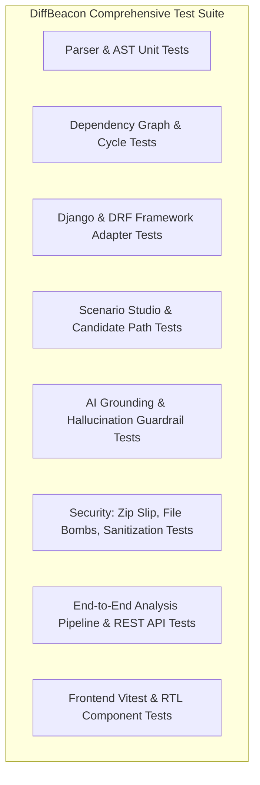

# DiffBeacon Testing Strategy & Verification Plan

**Version:** 1.0.0  
**Status:** Approved  
**Date:** October 2026  

---

## 1. Testing Philosophy

In DiffBeacon, **testing static analysis and AI grounding requires deterministic assertions**. Tests must never be flaky or rely on live external LLM calls.

---

## 2. Test Suites and Coverage Matrix

### 2.1 Backend Tests (`backend/tests/`)
- **`test_ingestion.py`**:
  - Tests valid ZIP extraction and hashing.
  - Tests rejection of archives containing path traversal (`../evil.py`).
  - Tests rejection of oversized archives and excessive file counts.
  - Tests classification of source, test, migration, and config files.
- **`test_parser.py`**:
  - Tests Python AST parsing on complex classes, functions, async methods, and decorators.
  - Tests call site extraction and attribute chains.
  - Tests import alias resolution (`from a.b import c as d`).
- **`test_framework_adapters.py`**:
  - Tests DRF serializer field extraction (`required`, `allow_null`, defaults).
  - Tests Django model field definitions and foreign keys.
  - Tests URL route parsing and view mapping.
- **`test_graph.py`**:
  - Tests directed graph creation, typed edge provenance, and cycle detection.
  - Tests bounded BFS impact traversal with hop limit.
  - Tests separation between Base graph and Head graph.
- **`test_analysis_pipeline.py`**:
  - Tests the complete 12-stage pipeline on the `BeaconWorks API` fixture.
  - Asserts detection of all 10 mandatory fixture cases (see Section 3).
- **`test_scenario_studio.py`**:
  - Tests scenario question normalization.
  - Tests candidate path extraction in base and head snapshots.
  - Tests the claim verifier: asserts that hallucinated files or line numbers are rejected.
- **`test_api_endpoints.py`**:
  - Tests DRF endpoints: `/api/v1/demo/`, `/api/v1/workspaces/`, `/api/v1/analyses/`, `/api/v1/scenarios/`.

### 2.2 Frontend Tests (`frontend/tests/`)
- **`Dashboard.test.tsx`**: Tests recent analyses listing, empty state, and demo launch trigger.
- **`ScenarioStudio.test.tsx`**: Tests starter questions, question submission, side-by-side trace display, and uncertainty badges.
- **`ImpactGraph.test.tsx`**: Tests node rendering, edge highlighting, and node click detail drawer.
- **`ContractMap.test.tsx`**: Tests contract diff badges (breaking vs non-breaking) and field details.
- **`EvidenceViewer.test.tsx`**: Tests code highlighting, line navigation, and base/head diff viewer.

---

## 3. Mandatory Fixture Cases (BeaconWorks API)

The test suite explicitly tests against 10 deliberate fixture scenarios:
1. **Changed Serializer Field:** `department_id` changed from required to optional in `EmployeeCreateSerializer`.
2. **Altered Validation Condition:** Minimum salary floor increased in `validate_compensation`.
3. **Modified Django Model Field & Migration:** `employment_status` default changed in `Employee` model.
4. **Changed Function with Known Callers & Tests:** `calculate_tax_deduction` calculation modified, with affected callers in payroll service and unit tests.
5. **Deleted Symbol with Remaining Reference:** Deprecated `legacy_format_ssn` removed while still referenced in `reporting.py`.
6. **Dynamic Relationship (Intentionally Unresolved):** Webhook dispatcher using `getattr(notifier, f'send_{channel}')`.
7. **Missing Source File:** Referenced configuration file absent in base or head.
8. **Ambiguous Base/Head Mapping:** Refactored helper function with similar signature in new module.
9. **Fully Supported Scenario:** Question *"What happens if a request omits department_id now?"* returns fully grounded before/after paths.
10. **Runtime-Dependent Scenario:** Question *"Does the database have department ID 1?"* correctly marked as `Unresolved (Runtime Verified Required)`.
